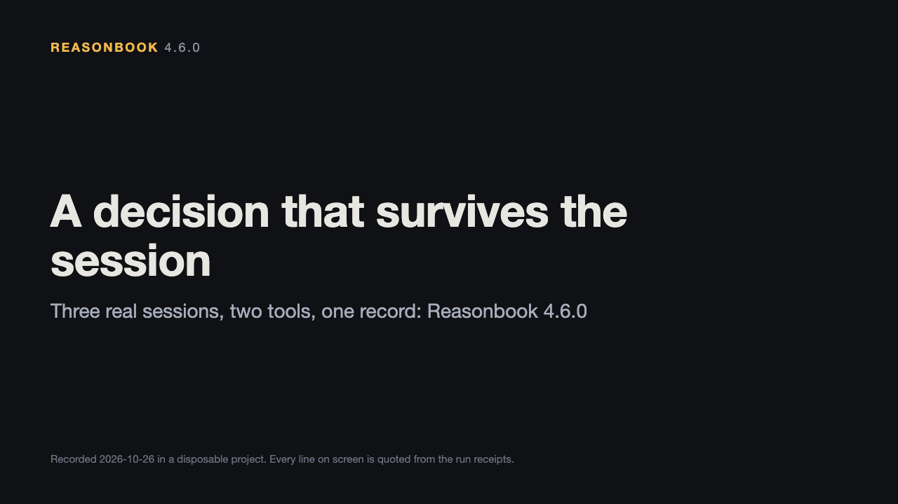
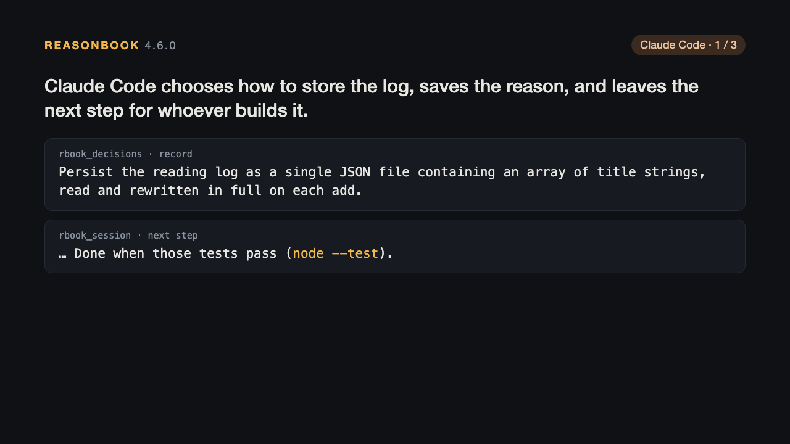
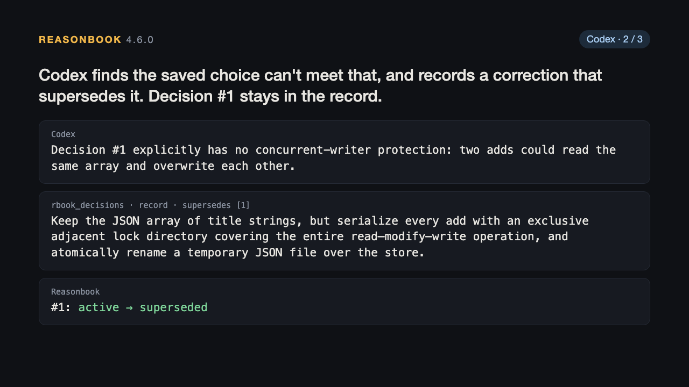
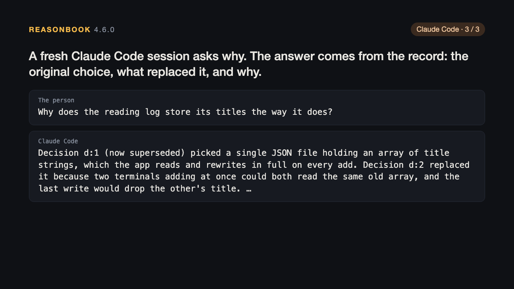

# The handoff demo

A 65-second replay of three real sessions recorded on 2026-10-25 with the released Reasonbook
4.6.0. Claude Code saves a choice and the next step. A new Codex session opens on that next step,
meets a changed requirement, records a correction that supersedes the first decision, then builds
and tests to it. A fresh Claude Code session asks why, and answers from the record.

[](reasonbook-handoff.mp4)

- [Video](reasonbook-handoff.mp4): MP4, 65 seconds, 1280×720.
- [Animated preview](reasonbook-handoff.gif): GIF, 65 seconds, 960×540. It loops; use the video to pause.

## What was verified

- **Package:** `@aquex/reasonbook`, version 4.6.0 from npm, installed through the published Claude Code
  and Codex plugins (`reasonbook@reasonbook`) into a scratch home. No manual MCP server.
- **Harnesses and models:** Claude Code 2.1.287 selected `claude-opus-5-5` in both Claude runs
  (from each run's init receipt). Codex CLI 0.164.0 ran `gpt-6-astra` at reasoning effort `high`
  (from its session log).
- **The project:** a new, disposable reading-log project initialized with `reasonbook init --level
builder`. Nothing was seeded into its record.
- **The record:** decision #1 (Claude Code) is superseded by decision #2 (Codex). The supersede
  receipt reads `#1: active → superseded`, and next step #1 was completed by Codex.
- **The code:** Codex's `node --test` passed 8 tests with 0 skipped, including simultaneous adds.
  An independent rerun after the session also passed 8 of 8.
- **Every line on screen** is a verbatim excerpt of a run receipt, checked by the build script
  before rendering. Ellipses mark cuts. Captions describe the receipts; they are not model output.

## Limits

- This is an excerpted replay, not a screen recording.
- The two lines labelled "The person" are the prompts given to the runs, typed by the demo
  coordinator on the operator's behalf. In the second session, the new requirement and the approval
  to correct the decision both came in that prompt.
- An earlier attempt in a separate project is kept with the receipts and supplies no frames. Its
  correction was refused, because that attempt's proposal became a pending draft that its approval
  never bound to.
- There is no dashboard frame. These runs used a local-only record.

## Stills







## Embedding

```html
<video
  src="reasonbook-handoff.mp4"
  poster="reasonbook-handoff-title.png"
  controls
  preload="metadata"
  width="1280"
>
  A 65-second recorded handoff. The transcript is at docs/demo/README.md.
</video>
```

GIF alt text: "A 65-second replay: Claude Code records a choice, Codex corrects it with a superseding
decision and passes its tests, and a fresh session explains why from the record."

## Transcript

### 1 / 3 · Claude Code records the choice

rbook_decisions · record

```text
Persist the reading log as a single JSON file containing an array of title strings, read and rewritten in full on each add.
```

rbook_session · next step

```text
… Done when those tests pass (`node --test`).
```

### 2 / 3 · Codex picks up, and the requirement changes

Codex, its first line, quoting the opening digest

```text
“n:1 Implement the dependency-free Node.js reading-log CLI per decision #1:…”
```

The person

```text
I often add books from two terminals at the same moment, and an add must never lose another add's title.
```

Codex

```text
Decision #1 explicitly has no concurrent-writer protection: two adds could read the same array and overwrite each other.
```

rbook_decisions · record · supersedes [1]

```text
Keep the JSON array of title strings, but serialize every add with an exclusive adjacent lock directory covering the entire read–modify–write operation, and atomically rename a temporary JSON file over the store.
```

Reasonbook

```text
#1: active → superseded
```

Codex, closing lines

```text
Record: reading-log-2 decision #2 supersedes #1; next step #1 completed.
Tests: `node --test` — 8 passed, 0 skipped, including simultaneous adds.
```

### 3 / 3 · A fresh session asks why

The person

```text
Why does the reading log store its titles the way it does?
```

Claude Code

```text
Decision d:1 (now superseded) picked a single JSON file holding an array of title strings, which the app reads and rewrites in full on every add. Decision d:2 replaced it because two terminals adding at once could both read the same old array, and the last write would drop the other's title. …
```
