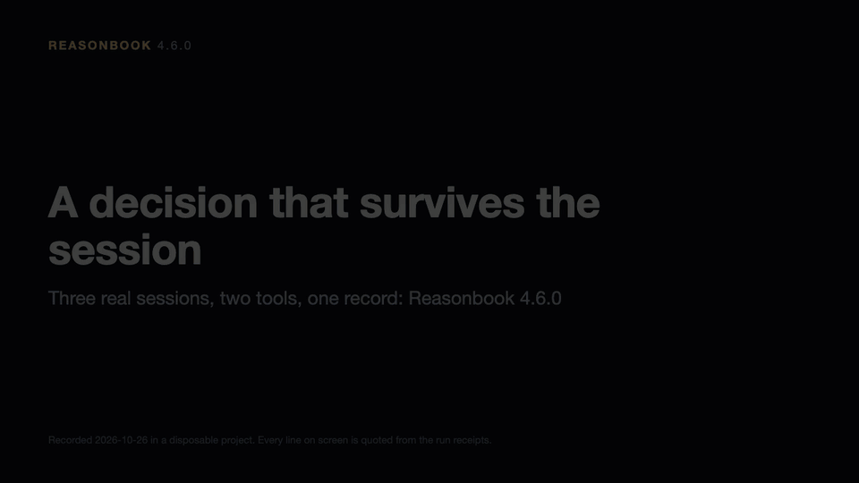

# Getting started with Reasonbook

For installation through your first recorded choice, start with [Your first ten minutes](first-ten-minutes.md).
For a first project digest, use the [three-step quickstart](../README.md#get-a-project-digest-in-three-steps). This guide covers MCP client configuration and an optional Builder walkthrough with a sprint, mission and session. A Ledger needs none of that ceremony. The dashboard at [reasonbook.ai](https://reasonbook.ai) is optional; ordinary project work runs locally without signing in.

For hooks, MCP prompts and client limitations, use the [harness coverage guide](harnesses.md).
For an existing CMOS installation, follow [the migration guide](migrating-from-cmos.md) before moving files.

[](https://github.com/kneelinghorse/reasonbook/blob/main/docs/demo/reasonbook-handoff.mp4)

The [demo receipts](https://github.com/kneelinghorse/reasonbook/blob/main/docs/demo/README.md) describe the recorded runs behind this 65-second replay.

## Prerequisites

- Node.js 20 or newer (`node -v`)
- An MCP client. Claude Code and Codex are verified (see the [harness guide](harnesses.md)); Claude Desktop, Cursor, Zed, VS Code (Claude extension) and Windsurf are untested.

## 1. Install the server

Pick one:

```bash
# Recommended: a global install of this release. It starts from disk, with no registry lookup.
npm install -g @aquex/reasonbook@4.12.0

# Or run on demand via npx: pinned, and preferring the local cache. The first launch downloads
# the package; later launches reuse the npm cache.
npx --prefer-offline -y @aquex/reasonbook@4.12.0
```

If you installed only a plugin, its private runtime does not add `reasonbook` to your terminal
PATH. For any CLI example here, replace `reasonbook` with
`npx --prefer-offline -y @aquex/reasonbook@4.12.0`, or install the pinned global CLI above.

If the former package is installed globally, run `npm uninstall -g @aquex/cmos-mcp` first. Version 4 provides only the `reasonbook` command; update scripts and MCP configurations that use the old command.

Verify it starts:

```bash
reasonbook --version  # if globally installed
# or
npx --prefer-offline -y @aquex/reasonbook@4.12.0 --version
```

Semantic (vector) search is optional: without it, retrieval is keyword-only and the install is about
45 MB. To add a vector term, install `@xenova/transformers` next to Reasonbook;
`rbook_db(action="health")` reports whether semantic search is on.

## 2. Wire it into your MCP client

Claude Code and Codex are verified; the other blocks follow each client's own MCP configuration and are untested with Reasonbook. Pick the block that matches your tool. Each example runs a pinned version through `npx`, preferring the local cache; to upgrade, change the version. With the global install, use `"command": "reasonbook"` and drop the `npx` arguments (keep `--project-root` where an example has it).

### Claude Code

```bash
claude mcp add-json rbook '{"command":"npx","args":["--prefer-offline","-y","@aquex/reasonbook@4.12.0"]}'
claude mcp list   # confirm it's registered
```

Claude Code runs from your workspace directory, so the next step's auto-discovery just works.

### Claude Desktop

Edit `~/Library/Application Support/Claude/claude_desktop_config.json` (macOS), `%APPDATA%\Claude\claude_desktop_config.json` (Windows), or `~/.config/Claude/claude_desktop_config.json` (Linux):

```json
{
  "mcpServers": {
    "rbook": {
      "command": "npx",
      "args": [
        "--prefer-offline",
        "-y",
        "@aquex/reasonbook@4.12.0",
        "--project-root",
        "/absolute/path/to/your/project"
      ]
    }
  }
}
```

Restart Claude Desktop. Claude Desktop is expected to start servers with no project context (on macOS,
from `/` with no workspace roots; untested with Reasonbook), so the config names the project: `--project-root` applies to calls that pass no
`projectRoot`, and only to this server entry. (If the project does not exist yet, create it in step 3
first.)

### Cursor

Edit `~/.cursor/mcp.json`:

```json
{
  "mcpServers": {
    "rbook": {
      "command": "npx",
      "args": ["--prefer-offline", "-y", "@aquex/reasonbook@4.12.0"]
    }
  }
}
```

### Zed

Edit your Zed `settings.json`:

```json
{
  "context_servers": {
    "rbook": {
      "command": "npx",
      "args": ["--prefer-offline", "-y", "@aquex/reasonbook@4.12.0"]
    }
  }
}
```

### VS Code (Claude extension)

Use the Claude Code command above from the integrated terminal, or add the server
through `/mcp` in the Claude panel. The extension and CLI share MCP configuration;
start a new conversation after changing it. The extension does not add `claude` to
your terminal PATH, so the terminal route needs the standalone Claude CLI.
[Claude Code in VS Code](https://code.claude.com/docs/en/vs-code#connect-to-external-tools-with-mcp)

### Windsurf

```json
{
  "mcpServers": {
    "rbook": {
      "command": "npx",
      "args": ["--prefer-offline", "-y", "@aquex/reasonbook@4.12.0"]
    }
  }
}
```

## 3. Initialize Reasonbook in your project

In your client, ask the agent to run:

```
rbook_project(action="init", projectRoot="/absolute/path/to/your/project", projectName="My Project", projectType="build")
```

`projectType="build"` starts the project at the Builder level, which keeps the sprints and missions the next steps use; without it a new project is a Ledger, which keeps decisions and lessons only (unless its folder's `AGENTS.md` already names a level; init's answer says which level it chose). This creates `rbook/db/rbook.sqlite` (the source of truth), a starter context, an `AGENTS.md` at the project root with the repository rules and one line naming the project's Reasonbook level, and a `CLAUDE.md` that imports it (an existing `AGENTS.md`, `agents.md` or `CLAUDE.md` is left as it is). Use the absolute path for clarity — relative paths resolve against the agent's CWD, which varies.

Commit `AGENTS.md`, `CLAUDE.md`, `rbook/.gitignore` and the project documents you maintain.
Init creates the ignore file only when missing, covering the SQLite store, WAL/SHM files and
snapshots. Keep those runtime files out of Git; a shared record refuses a tracked store.

On Claude Desktop, the `--project-root` from step 2 points the server at this project. A machine-wide
alternative, used by any server that starts with no project context and no `--project-root`:

```
rbook_project(action="register", projectRoot="/absolute/path/to/your/project", setAsDefault=true)
```

Claude Code and Codex resolve the project from the working directory (or the nearest folder above it
holding `rbook/db/`) and need neither; the other clients are untested here.

## 4. Cold-start the agent

```
rbook_agent_onboard()
```

You'll get a single payload with project identity, the active sprint (if any), pending missions, recent decisions, context freshness, and suggested actions. Recent decisions use 300-character previews with IDs; read one decision in full with `rbook_decisions(action="show", decisionId=…)`. These previews limit individual history entries, not the complete response: orphan diagnostics, warnings and full project identity/context fields can make it exceed 28 KB. `rbook_agent_onboard` is the **cold-start / fresh-project** entry point — if this is a fresh project the payload includes `freshProject: true` and a `tierSelectionPrompt`, and the first suggested action is to follow it.

For an **ongoing** session (a project that already has state), open with `rbook_review` instead.
Its text shares the session-start and `reasonbook review --format=context` digest: project and sprint,
the approved operator profile, rules in force, recent decisions and learnings, and open work.
The local core stays within 4,000 characters; MCP appends portfolio context below the pointer.
The structured digest is separately trimmed toward a 4,096-byte budget; provenance and the surrounding MCP response are outside that budget.

The first eligible `reasonbook hook prompt` in each harness session and store recalls up to five
decisions using the prompt’s keywords and one hop of explicit local decision citations. No vector
model is needed. Previews share a 1,500-character budget; open a decision by ID for its full text.
A successful empty search counts as the first attempt, while failed reads and deadlines allow a
retry. Later eligible prompts recall at most three unseen local decisions matching at least three
keywords; short replies, slash commands and plain approvals skip that recall. Pending draft offers
and replies are handled before these skip rules. Resume and compact
retain the first-prompt state in `<configDir>/runtime/recall/`; removing that external runtime state
resets it. A process crash after stdout but before its completion commit can repeat the previews.

## 5. Plan your first sprint

```
rbook_sprint(action="add", sprintId="sprint-01", title="First sprint", focus="Ship the first end-to-end feature")
```

```
rbook_session(action="start", type="planning", title="Plan sprint 01", sprintId="sprint-01")
```

Starting a session is optional. A capture made without one lands in an implicit session that the server opens for its process and closes when the process ends. Start one explicitly when you want the work titled, typed or tagged to a sprint; `sprintId` may name any existing sprint, including a planned one.

Capture decisions as you make them:

```
rbook_session(action="capture", category="decision", content="Use device-code auth for the dashboard handshake")
```

```
rbook_session(action="capture", category="next-step", content="Wire rbook_status into the onboarding banner")
```

## 6. Add and start a mission

```
rbook_mission(action="add", missionId="s01-m01", name="First mission", sprintId="sprint-01",
             objective="Deliver the first end-to-end feature",
             successCriteria=["Feature works", "Tests pass", "Snapshot taken"])
```

```
rbook_mission_transition(action="start", missionId="s01-m01")
```

The transition tool surfaces relevant past decisions via FTS5 keyword overlap when you start a mission, so prior context flows in automatically.

## 7. Complete the work

Review and sprint close warn about a stale build only in a project whose build writes
`dist/.build-manifest.json`, as Reasonbook's own does. To turn that warning off there, set
`build_freshness_check` to false; any other value, or none, keeps it:

```text
rbook_context(action="update", contextType="project_identity",
              fieldUpdates=[{"path":"type_fields.build_freshness_check","value":false}])
```

This changes the project's advisory, not its own release or validation requirements. A check
that cannot run says so: "Build freshness could not be checked", with the reason.

When the work is verified, record what you decided in its own call, then finish the mission with notes only:

```
rbook_decisions(action="record", missionId="s01-m01",
               content="Chose event sourcing for the audit trail")
```

```
rbook_mission_transition(action="complete", missionId="s01-m01",
                        notes="Built feature X, added tests, snapshotted DB before migration")
```

Keep the two apart. Some hosts drop a closing tag when a long free-text parameter and an array share
one call, and the array is absorbed into the text; the server refuses such a completion rather than
completing without your decisions.

```
rbook_session(action="complete", summary="Sprint 01 first mission shipped")
```

## 8. Check the state

```
rbook_review()
```

The digest names the active sprint, lists the decisions you recorded under recent decisions, and shows the open work, where the next mission in the queue (if any) is the natural pull; a completed mission leaves the open work. `rbook_review` is the opener to reach for at the top of every ongoing session.

```
rbook_status()
```

Returns five health fields (`rbook_address`, `dashboard_url`, `auth_tier`, `last_sync_at`, `last_delivery_observed_at`), plus the common `projectRoot` and `resolvedBy` provenance fields on the successful MCP response. Use it to inspect project attribution and dashboard status; with credentials, status may query the dashboard.

That's the loop: **review → start mission → execute → complete → review**; `rbook_agent_onboard` is for a project's first session. Sprints close with `rbook_sprint(action="complete")`, which stamps the close time, attempts database snapshots before and after the close and a context snapshot, and clears the closed sprint's session notes from project_context. Database snapshot failures warn without blocking the close; required context-snapshot failures roll the close back. The sprint's decisions and learnings stay active unless you pass `archive: true`.

## Local mode is the default

With the default install and no dashboard sign-in, nothing above used the network once the package was installed: there is no credential, so nothing is uploaded, and without the optional `@xenova/transformers` no model is downloaded. Your data lives in `rbook/db/rbook.sqlite`. Append-only events protect your audit trail. `rbook_db(action="snapshot")` copies the database whenever you ask, and Reasonbook requires a backup before a restore or a snapshot prune with selected rows. Sprint close attempts backups before and after its changes, warning if either fails. Nothing else snapshots first, so take one before anything else destructive.

If you stay in local mode, you can ignore the hosted dashboard section.

## Reporting friction

Report Reasonbook friction when it happens; no session or mission is required:

```bash
reasonbook feedback --content 'What happened, what was expected, and how to reproduce it.'
```

Use `--project-root /path/to/project` to name the affected project, `--dry-run` to preview,
or `--format json` for a receipt. The package includes `plugins/reasonbook/skills/feedback/SKILL.md` for agents.
`rbook_feedback(action="list", acrossProjects=true)` reads the registered fleet and reports
full filtered counts beside the capped newest rows (4 a page by default, 2 at status resolved; 200
maximum). Unavailable stores make the coverage partial; absent feedback tables count as zero. All
rows are counted, without deduplication or subject filtering. Each list also counts the rows by kind
(`countsByKind`: ceremony, surfacing, identity, sync, payload), by published rules over each
row's text, with `unclassified` beside them. Local triage accepts `resolutionNote`, and `resolve`
takes local `feedbackIds` for up to 200 rows at once; an unknown id resolves none. Its receipt
names the project and lists skipped rows that were already resolved, preserving their first
resolution time and note. Fleet entries use opaque project-qualified ids such as
`project-id:feedback:12`, which local mutation calls refuse. For a sibling disposition, request
action through an explicitly authorized message to that project.

Feedback that a shipped release already fixed is marked where it is read. Each list labels such a
row "fixed in X (rule)", or "partly fixed in X" when it also names something else, and counts
every row in three groups (`countsByGroup`): fixed by a shipped release, about Reasonbook, and
about the project's own work, with the rules that sorted them. In a project, the dry run lists the
rows a shipped release fixed; `--apply` resolves those still open with no note, naming the release
in each row's note and leaving a triaged or noted row to its person; and `reopen-fixed` gives back
the rows a rule resolved that nobody has changed since and its ledger still names:

```bash
reasonbook feedback resolve-fixed
reasonbook feedback resolve-fixed --apply
reasonbook feedback reopen-fixed --rule reads.fan-out-every-project
```

Only the project the command runs in is changed; another project's rows are labelled, never
resolved.

## What needs a person, across your projects

`reasonbook signals` reads every project registered on this machine, read-only, and reports ten
signals for each: drafts awaiting a decision, next steps about to lapse, records due for review,
rows citing a replaced decision, blocked missions, open agent friction by kind, days since the
newest row in the record's six main tables, constraints about to expire, a shared copy's
unsettled conflicts, and work whose date has come: next steps dated with `checkAfter` and deferred
missions dated with `deferUntil`.

```bash
reasonbook signals
reasonbook signals --project-root /path/to/project --format json
```

Each signal gives its count and up to 5 row ids (20, and the rule that counted it, with
`--format json`). A signal the store cannot answer, such as drafts in a store made before drafts
existed, reads unavailable with its reason, never zero. A draft also expires after three session
starts, which only this machine's draft runtime records. `rbook_review` shows the five signals that need a person
(drafts, next steps about to lapse, blocked missions, conflicts and work that is due) for up to eight of your other
projects, in its portfolio.

The signals come from a library, `@aquex/reasonbook/signals`: `readSignals(storePath, { now })`
reads one store file at the time given. It never writes the store or starts anything, and the same
file, time and draft runtime give the same report. SQLite may create `-shm` and empty `-wal`
sidecars. The report uses one consistent read transaction: on a rollback-journal store its
shared lock lasts until the report finishes, so a writer with a shorter busy timeout (including
250 ms) can fail. `rbook_review` skips locked sibling stores without waiting and stops admitting
portfolio stores after one second; unfinished coverage is reported as unreadable. This deadline
is checked between synchronous reads, so it cannot interrupt a query already executing.

`reasonbook brief` turns those reports into a one-page weekly brief: what needs a decision, what is
stuck, what is due, what has gone quiet, what is drifting, the week's friction and what moved, five items a
section with every listed row named by its id. `--days` sets the window (7 by default) and
`--format json` prints the sections as data. The same renderer, `renderBrief`, gives the same bytes
for the same reports on any machine.

The brief labels older reports with their age and reports that counted a different window with
that window. Friction includes unclassified feedback. Text display removes control characters,
neutralizes automatic links and caps names and ids; JSON retains the full ids and report provenance.
The rendered brief stays within 60 lines and says when additional items or caveats were omitted.

## Local usage statistics

MCP calls and CLI commands record best-effort measurements under
`~/.config/rbook/telemetry/<store-hash>/<YYYY-MM>.jsonl` (or the configured
`RBOOK_CONFIG_DIR`). The hash combines project identity and the physical store path, so a scratch
copy has its own measurements. Files stay outside repositories and SQLite, are never checkpoint
uploads, and retain only the three newest monthly files on the next append. A config directory
inside a repository disables recording there. Unattributed calls use a separate bucket that
project reports exclude.

Measurements contain typed record IDs, counts, hashes, technical client/tool names and outcomes.
Prompt text and record bodies are never written. Prompt hooks match the published procedure
patterns and rules before skip handling, including when ambient injection is off. Logging failure
does not fail the operation; missing files and unreadable measurements are reported as unavailable.

```bash
reasonbook stats --project-root /path/to/project
reasonbook stats --project-root /path/to/project --since 2026-10-01 --until 2026-10-31 --export
# Pool explicitly selected projects; repeat --include-project as needed.
reasonbook stats --project-root /path/to/project --include-project /path/to/another
```

The default window is the last 14 days, with September 2026 as the fixed G1 baseline. Override it
with `--baseline-since` and `--baseline-until`. The human report includes local record details for
review; `--export` emits aggregate counts, ratios and fixed counting rules, with no record content,
record IDs, session IDs, project names or paths.

Each report states its counting rules. Decision timing requires at least 15 qualifying missions
per project in both periods and uses a two-minute window either side of mission completion.
Cite-through joins later successful use to a typed injected ID in the same store and harness
session; PID-only sessions cannot establish that denominator. Foreign records are excluded from
local-ID measurements. Zero observed prompting does not establish hook coverage. Pattern matching
can miss unfamiliar phrasing, and best-effort logging can miss events. Proposal metrics use the drafts stored in the project when that table is available; the report
states each denominator and unavailable measure. Semantic duplicate and contradiction judgments
and friction severity require review. Digest-off comparisons are observational and deferred until
after G1.

## Share a project's record

<a id="through-reasonbookai"></a>
<a id="directly-over-ssh"></a>
<a id="join-by-bundle"></a>
<a id="conflicts-and-removal"></a>

The [sharing guide](sharing.md#share-a-projects-record) covers [reasonbook.ai](sharing.md#through-reasonbookai), [SSH](sharing.md#directly-over-ssh), [bundles](sharing.md#join-by-bundle), and [conflicts and removal](sharing.md#conflicts-and-removal).

## Optional: connect the hosted dashboard

<a id="sign-up"></a>
<a id="connect-from-reasonbook"></a>
<a id="what-happens-next"></a>
<a id="verify"></a>

The [hosted dashboard guide](sharing.md#optional-connect-the-hosted-dashboard) covers sign-in, whole-file uploads, failure handling and the controls that stop each transfer.

## Rename an owned project

Starting in 4.12.0, preview a name and slug change with:

```bash
reasonbook rename --name "My Project" --slug my-project --project-root /path/to/project
```

Use `--apply` to make the change while no other session is working in that project. The name must
derive to the slug by lowercasing and replacing whitespace with hyphens. Slugs contain lowercase
letters and digits separated by single hyphens. Sign in as the store's owner; shared records and
members' copies cannot be renamed.

The command renames the dashboard display name and slug, updates the local identity and registry,
and uploads the store. Project ids stay the same, and it does not move the project folder.
`reasonbook migrate` separately moves a CMOS-era record folder to `rbook/`. If the dashboard changes
but the local write fails, the answer says so: resolve the reported cause and run the same rename
again. A lookup using an old local address names the new address to use.

## Where to next

- [Harness coverage](harnesses.md) — hooks, MCP prompts, verification limits and the fallback without hooks.
- [Tool reference](../TOOL_REFERENCE.md) — every tool, action, and parameter (generated from the tool definitions).
- [Changelog](../CHANGELOG.md) — release notes and tool-surface changes.
- [GitHub issues](https://github.com/kneelinghorse/reasonbook/issues) — bug reports and feature requests.

## Troubleshooting

**The setup looks wrong** (no Reasonbook hooks run, two Reasonbook servers answer, an old version
runs, a project still uses the old `cmos/` folder): `reasonbook doctor` lists the setup drift on this
machine and the fix for each, in the order to apply them. It writes nothing; `--format json` gives
the same as data, and `--offline` skips its one lookup of the latest version on npm.

**A tool answers "No Reasonbook project in '<dir>'"** (or, for a `projectRoot` you passed, `RBOOK_NOT_DETECTED`: "Reasonbook directory not found starting from '<dir>'"): that folder has no `rbook/db/rbook.sqlite`. Either `cd` into a project that has one, pass the right `projectRoot`, or start a record there with the init call the answer names, at the level step 3 uses: `rbook_project(action="init", projectRoot="<dir>", projectType="build")`.

**A client shows the server but tools return errors**: a client that starts servers without a project folder gives the server no project. Add `"--project-root", "/absolute/path/to/your/project"` to the server's `args` (step 2), or set a default with `setAsDefault` (step 3). A default set before 3.2.0 must be re-confirmed with `setAsDefault` before it applies.

**A dashboard tool returns `DASHBOARD_NOT_CONFIGURED`**: there is no dashboard credential yet. Sign in with `rbook_auth(action="login_init")` and `login_complete`. The dashboard URL is not the cause: an unset or empty `RBOOK_DASHBOARD_URL` means `https://reasonbook.ai`.

**Tool calls show as unauthorized after a successful login**: the local credential store may be on a different config dir than the running server. Check `RBOOK_CONFIG_DIR` matches across your shell and MCP client launch env.

**Dashboard returns HTTP 402** (`DASHBOARD_UPGRADE_REQUIRED`): the dashboard refused a feature this account does not include. The error includes a sign-up pointer.
